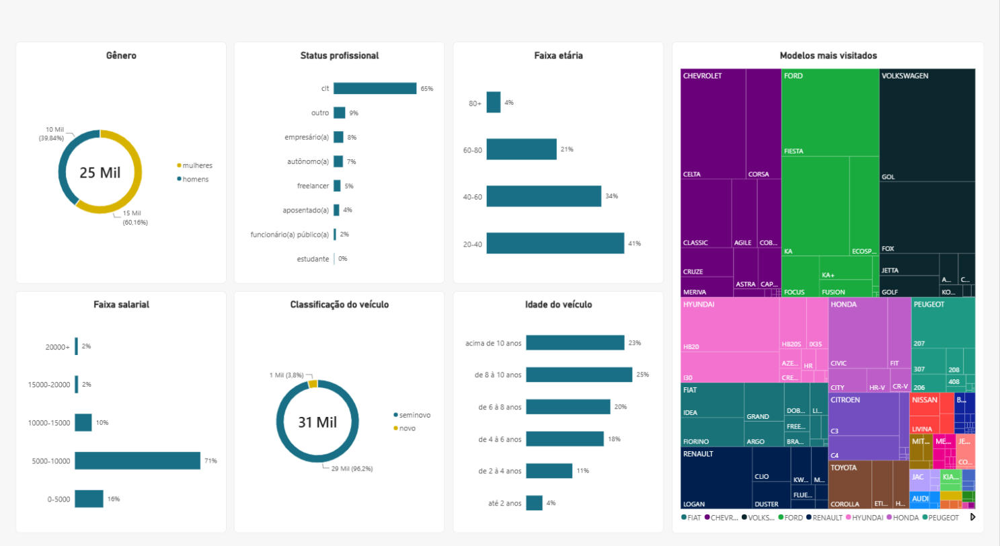

# Dashboard de Análise de Perfil dos Clientes

Dashboard em **Power BI** que mostra **quem são os leads** de uma empresa de venda de veículos e **quais veículos eles visitam**. Os dados vêm de um banco **PostgreSQL**, consultados com 7 queries em SQL.

Projeto prático do curso *SQL para Análise de Dados*, o segundo da série. O primeiro, de vendas, está em [Dashboard-de-Vendas](https://github.com/gabi-vasconcelos/Dashboard-de-Vendas).



## Perguntas de negócio

Cada visual responde a uma pergunta do time comercial e de marketing:

| Visual | Pergunta de negócio | Query |
|---|---|---|
| Gênero (rosca) | Qual a divisão de gênero dos leads? | [01](queries/01_genero_dos_leads.sql) |
| Status profissional (barras) | Qual a ocupação dos leads: CLT, autônomo, empresário, estudante...? | [02](queries/02_status_profissional.sql) |
| Faixa etária (barras) | Em que faixas de idade estão os leads? | [03](queries/03_faixa_etaria.sql) |
| Faixa salarial (barras) | Qual a renda dos leads? Eles têm perfil para os veículos do catálogo? | [04](queries/04_faixa_salarial.sql) |
| Classificação do veículo (rosca) | Os leads visitam mais veículos novos ou seminovos? | [05](queries/05_classificacao_dos_veiculos.sql) |
| Idade do veículo (barras) | Qual a idade dos veículos visitados? | [06](queries/06_idade_dos_veiculos.sql) |
| Modelos mais visitados (treemap) | Quais marcas e modelos concentram mais visitas? | [07](queries/07_veiculos_mais_visitados.sql) |

## O que os dados mostram

- **Gênero:** 60,16% dos leads são mulheres e 39,84% são homens.
- **Status profissional:** 65% dos leads são CLT, e nenhum dos outros status passa de 9%.
- **Faixa salarial:** 71% dos leads ganham entre R$ 5.000 e R$ 10.000.
- **Classificação:** 96,2% das visitas são a veículos seminovos, só 3,8% a novos.
- **Idade do veículo:** cerca de 48% das visitas são a veículos com mais de 8 anos de uso.
- **Modelos:** Chevrolet, Ford e Volkswagen são as marcas com mais visitas.

## Regras de negócio

- Veículo **novo**: até 2 anos de idade na data da visita. **Seminovo**: acima de 2 anos.
- A idade do veículo é `ano da visita - ano do modelo`.
- Faixas de idade do veículo: até 2, de 2 a 4, de 4 a 6, de 6 a 8, de 8 a 10 e acima de 10 anos.
- Faixas salariais (R$): 0-5.000, 5.000-10.000, 10.000-15.000, 15.000-20.000 e 20.000+.

## Atenção à faixa etária

A idade dos leads é calculada com `current_date` (Query 3), então os percentuais da faixa etária **mudam conforme o dia em que a query é executada**. Os valores do print foram gerados em 24/11/2026. Para obter um resultado fixo, troque `current_date` por uma data de referência.

## Como reproduzir

1. Tenha o banco do curso no PostgreSQL, com os schemas `sales` e `temp_tables`. A base não está neste repositório.
2. Execute [`queries/00_funcao_datediff.sql`](queries/00_funcao_datediff.sql) uma vez. O PostgreSQL não tem `datediff` nativo, e a Query 3 depende dela.
3. Abra `Análise de Perfil dos Clientes.pbix` no Power BI Desktop e, em *Transformar dados*, ajuste a conexão (`localhost`, banco `postgres`) para o seu ambiente.
4. Atualize os dados.

## Ferramentas

- PostgreSQL (SQL com CTEs, `case when`, junções e funções de data)
- Power BI Desktop (Power Query, rosca, barras e treemap)

## Estrutura

```
├── Análise de Perfil dos Clientes.pbix
├── imagens/
│   └── dashboard.jpg
└── queries/
    ├── 00_funcao_datediff.sql
    ├── 01_genero_dos_leads.sql
    ├── ...
    └── 07_veiculos_mais_visitados.sql
```

---

Feito por **Gabriela Vasconcelos**
